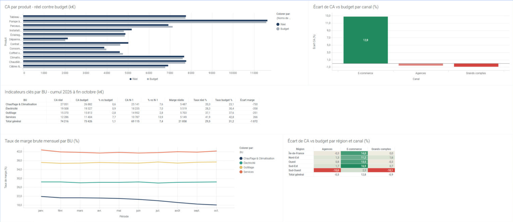
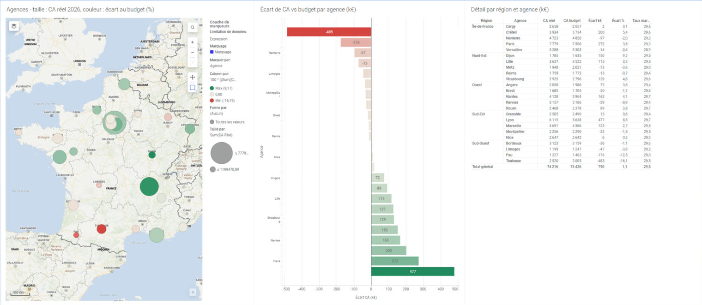
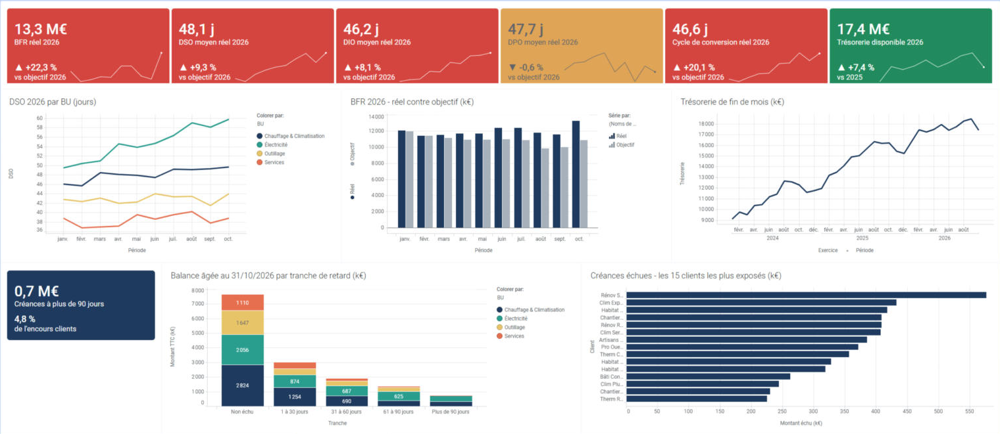
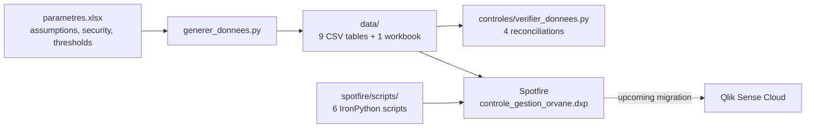

<p align="center">
  
</p>

<h1 align="center">Migrating a management control dashboard<br />from Spotfire to Qlik Sense</h1>

<p align="center">
  A 5-tab Spotfire dashboard, built entirely from versioned scripts,
  on a fictional 14,892-row dataset, as the starting point for a migration to Qlik Sense Cloud.
</p>

<p align="center">
  <a href="README.md"></a>&nbsp;<a href="README.en.md"></a>
</p>

<p align="center">
  <a href="LICENSE"></a>
  <a href="https://github.com/cnanaj-wq/migration-spotfire-qlik-sense/actions/workflows/controle.yml"></a>
  
  
</p>

<p align="center">
  
  
  
  
  
  
  
  
  
  
</p>

<p align="center">
  <a href="#quick-start"><b>Quick start</b></a>
  &nbsp;·&nbsp; <a href="#architecture">Architecture</a>
  &nbsp;·&nbsp; <a href="docs/reproduire.md">Rebuild in Spotfire (French)</a>
  &nbsp;·&nbsp; <a href="#limitations">Limitations</a>
  &nbsp;·&nbsp; <a href="CHANGELOG.md">Changelog (French)</a>
</p>

## Quick start

Prerequisite: Python 3.12. Spotfire is only needed to open the dashboard.

```powershell
git clone https://github.com/cnanaj-wq/migration-spotfire-qlik-sense.git
cd migration-spotfire-qlik-sense
pip install -r requirements.txt
python generer_donnees.py
python controles/verifier_donnees.py
```

Expected result: the 9 files in `data/` are regenerated identically, then the check prints 4 `OK` lines and `Tout concorde` ("everything reconciles").

## Choose your next step

| You want to… | Go here |
|---|---|
| Open the dashboard in Spotfire | [docs/reproduire.md](docs/reproduire.md) |
| Read how a tab is built | [`spotfire/scripts/`](spotfire/scripts/) |
| Understand the dataset | [`generer_donnees.py`](generer_donnees.py) |
| Change the assumptions (budget, security, thresholds) | [`parametres/parametres.xlsx`](parametres/) |
| Check that the tables reconcile | [`controles/verifier_donnees.py`](controles/verifier_donnees.py) |

## Why this project

Migrating a dashboard from one tool to another is more than redrawing charts: the two engines do not compute or select data the same way. Showing that on a complete case required a realistic starting application that can be rebuilt and holds no confidential data.

This repository holds that application: the steering of a fictional company, Orvane Distribution, as seen by its management control team. It answers four questions: which indicators drift, where, why, and which lever to act on.

## What is inside

| Item | Count | Where |
|---|---|---|
| Dashboard tabs | 5 | [`spotfire/controle_gestion_orvane.dxp`](spotfire/) |
| Visuals (including 5 rows of 21 KPI tiles) | 25 | [`spotfire/scripts/`](spotfire/scripts/) |
| IronPython build scripts | 6 | [`spotfire/scripts/`](spotfire/scripts/) |
| Data tables (CSV) | 9 | [`data/`](data/) |
| Data rows | 14,892 | [`data/`](data/) |
| Reconciliation checks | 4 | [`controles/verifier_donnees.py`](controles/verifier_donnees.py) |

The five tabs:

| Tab | What it shows |
|---|---|
| Executive summary | Revenue, gross margin, margin rate, EBITDA and working capital: actual, gap to budget, gap to prior year |
| Revenue and margin | Revenue by product, gap by channel, indicators by business unit, monthly margin rate |
| Branch map | 24 branches on a map, ranking of revenue gaps in value |
| Variances and income statement | Volume, price and purchase cost effects, income statement with intermediate balances |
| Working capital, cash and aged balance | Working capital, DSO, DIO, DPO against target, cash, overdue receivables |

The dashboard, the data columns and the scripts are in French.

## Preview

The starting application in Spotfire, "Executive summary" tab. Screenshots of the application migrated to Qlik Sense will be added alongside.

<p align="center">
  
</p>

<details>
<summary>See the other four tabs</summary>

**Revenue and margin**



**Branch map**



**Variances and income statement**


**Working capital, cash and aged balance**



</details>

## Architecture



The dashboard is not drawn by hand. A launcher script, stored in the Spotfire document, runs [`construire_tout.py`](spotfire/scripts/construire_tout.py), which recreates the five tabs from the scripts in this repository. Every change to a visual is therefore a code change, reviewed and versioned.

## Results

Year-to-date figures at the end of October 2026, read in the dashboard and reconciled with the files in `data/`:

| Indicator | Actual | Budget | Gap |
|---|---|---|---|
| Revenue | 74,216 k€ | 73,426 k€ | +790 k€ |
| Gross margin | 21,858 k€ | 22,930 k€ | −1,072 k€ |
| EBITDA | 5,312 k€ | 6,550 k€ | −1,238 k€ |
| Operating income | 3,863 k€ | 5,102 k€ | −1,238 k€ |

The scenario is deliberate: the company sells more than planned, but its margin deteriorates. To recompute revenue and the margin gap: `python controles/verifier_donnees.py`.

## Repository map

```
generer_donnees.py      generates the fictional dataset from the parameters
creer_parametres.py     creates the initial parameter workbook (once)
parametres/             assumptions, security by region, alert thresholds
data/                   9 CSV tables and the same content as an Excel workbook
controles/              consistency check across tables
spotfire/               the Spotfire document and its build scripts
docs/                   Spotfire how-to, banner script
img/                    README visuals and screenshots
```

## Limitations

- **The migration to Qlik Sense is not done yet.** The repository currently holds the starting application. The Qlik model, expressions and sheets will follow.
- **Security by region is not enforced in Spotfire.** The `securite` table is ready for Qlik Section Access; the Spotfire trial used here cannot test it.
- **The build cannot run outside Spotfire.** IronPython scripts only run inside Spotfire; the repository's automated check only verifies their syntax.

## What is new

- **2026-11-25**: 5-tab Spotfire dashboard, dynamic selections across tables, data consistency check.

Full history: [CHANGELOG.md](CHANGELOG.md).

## Contributing, security, license

[Contributing](CONTRIBUTING.md) · [Report a security issue](SECURITY.md) · [MIT](LICENSE) license.

Spotfire and Qlik are trademarks of their respective owners. This repository is independent of these vendors.

## Author

**Cédric NANA** · BI & Data consultant · [GitHub](https://github.com/cnanaj-wq)

Personal experiment on synthetic data.
