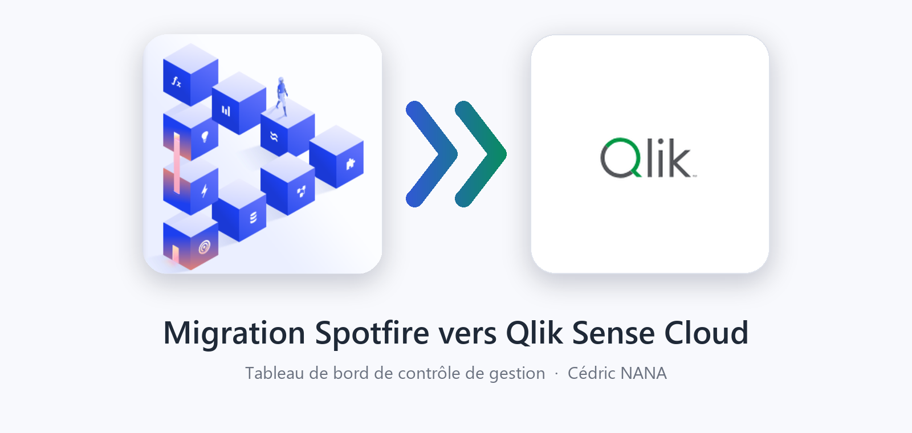
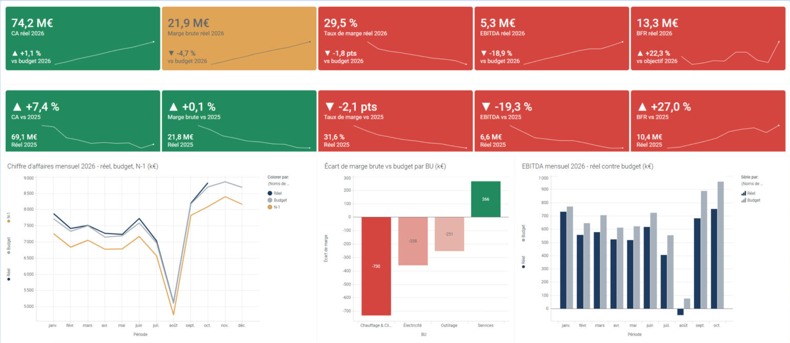
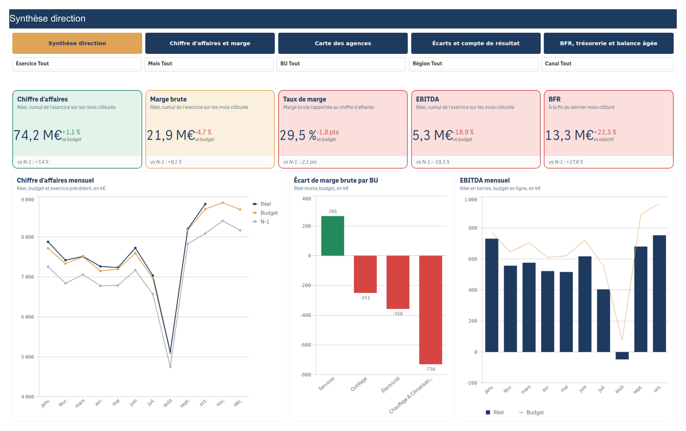
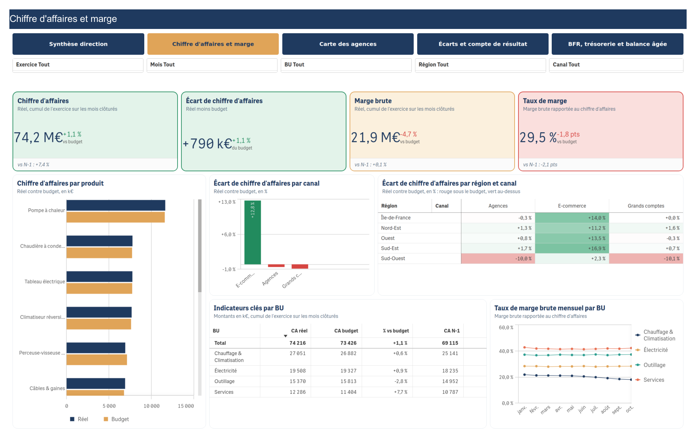
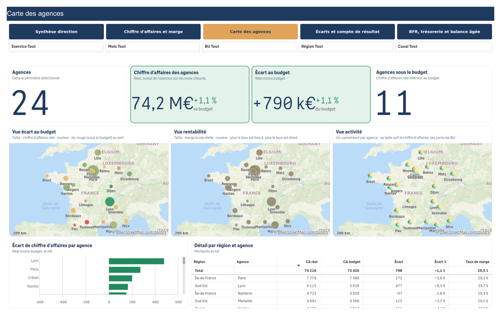
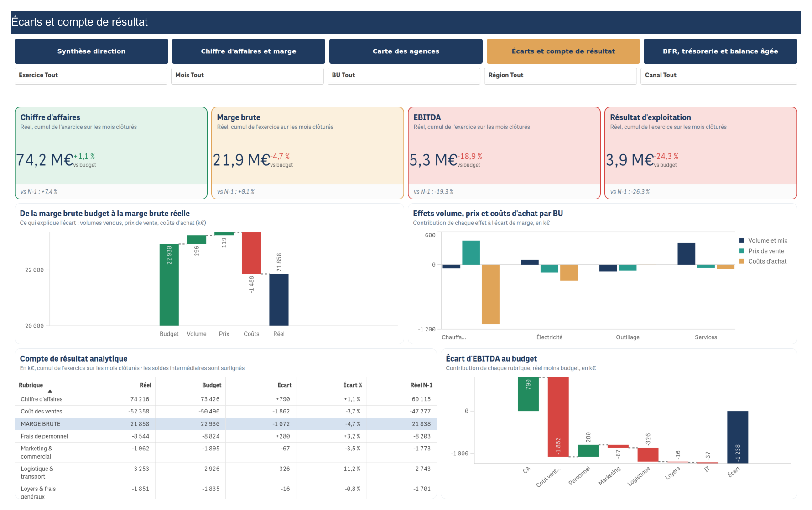
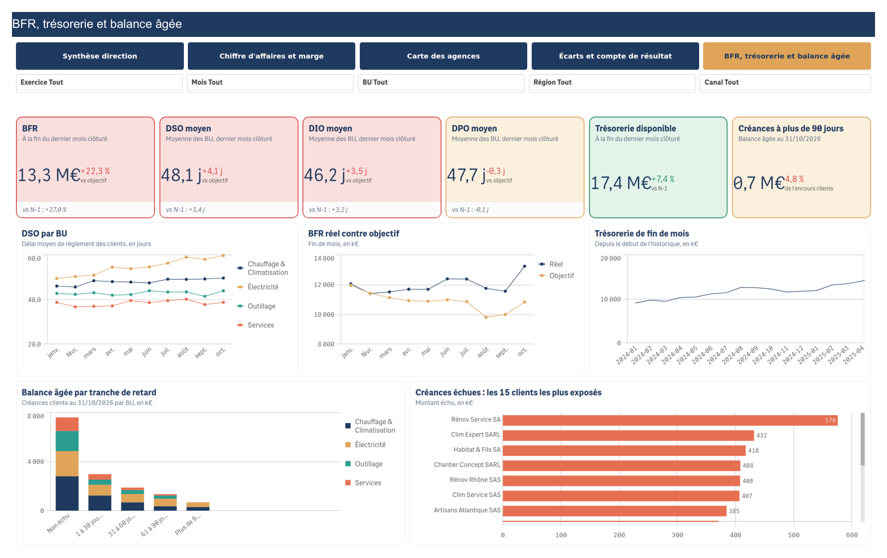
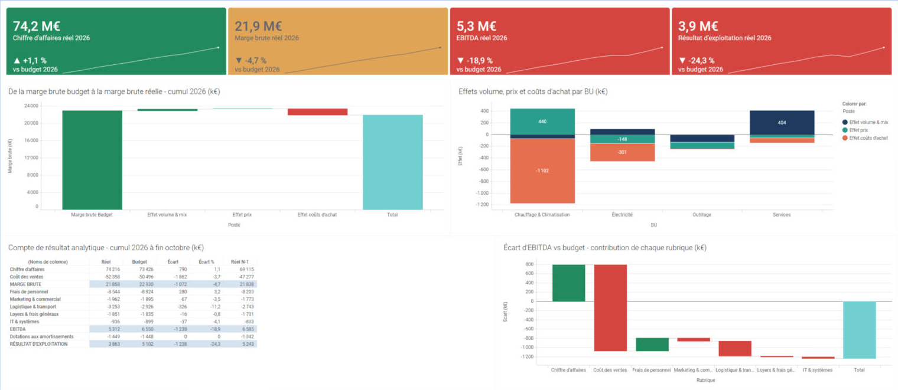
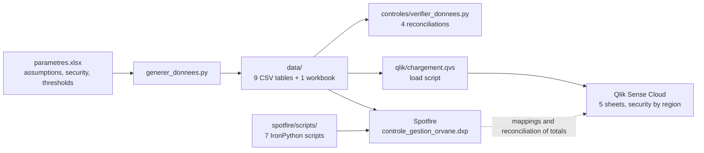
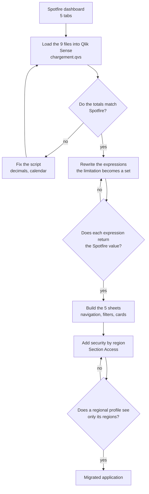

<p align="center">
  
</p>

<h1 align="center">Migrating a management control dashboard<br />from Spotfire to Qlik Sense</h1>

<p align="center">
  A 5-tab Spotfire dashboard, built from versioned scripts on a fictional 14,892-row dataset,
  then migrated to Qlik Sense Cloud: data model, expressions, 5 sheets and security by region.
</p>

<p align="center">
  <a href="README.md"></a>&nbsp;<a href="README.en.md"></a>
</p>

<p align="center">
  <a href="LICENSE"></a>
  <a href="https://github.com/cnanaj-wq/migration-spotfire-qlik-sense/actions/workflows/controle.yml"></a>
  
  
</p>

<p align="center">
  
  
  
  
  
  
  
  
  
  
</p>

<p align="center">
  <a href="#quick-start"><b>Quick start</b></a>
  &nbsp;·&nbsp; <a href="#architecture">Architecture</a>
  &nbsp;·&nbsp; <a href="#flowchart">Flowchart</a>
  &nbsp;·&nbsp; <a href="docs/reproduire.md">Rebuild in Spotfire (French)</a>
  &nbsp;·&nbsp; <a href="qlik/correspondances.md">From Spotfire to Qlik (French)</a>
  &nbsp;·&nbsp; <a href="#limitations">Limitations</a>
</p>

## Quick start

Prerequisite: Python 3.12. Spotfire is only needed to open the dashboard.

```powershell
git clone https://github.com/cnanaj-wq/migration-spotfire-qlik-sense.git
cd migration-spotfire-qlik-sense
pip install -r requirements.txt
python generer_donnees.py
python controles/verifier_donnees.py
```

Expected result: the 9 files in `data/` are regenerated identically, then the check prints 4 `OK` lines and `Tout concorde` ("everything reconciles").

## Choose your next step

| You want to… | Go here |
|---|---|
| Open the dashboard in Spotfire | [docs/reproduire.md](docs/reproduire.md) |
| Read how a tab is built | [`spotfire/scripts/`](spotfire/scripts/) |
| Understand the dataset | [`generer_donnees.py`](generer_donnees.py) |
| Change the assumptions (budget, security, thresholds) | [`parametres/parametres.xlsx`](parametres/) |
| See what changes between Spotfire and Qlik Sense | [qlik/correspondances.md](qlik/correspondances.md) |
| Load the data into Qlik Sense | [`qlik/chargement.qvs`](qlik/chargement.qvs) |
| Redo the migration with scripts, not by hand (LAB 02, in French) | [lab02/README.md](lab02/README.md) |
| Check that the tables reconcile | [`controles/verifier_donnees.py`](controles/verifier_donnees.py) |

## Why this project

Migrating a dashboard from one tool to another is more than redrawing charts: the two engines do not compute or select data the same way. Showing that on a complete case required a realistic starting application that can be rebuilt and holds no confidential data.

This repository holds that application: the steering of a fictional company, Orvane Distribution, as seen by its management control team. It answers four questions: which indicators drift, where, why, and which lever to act on.

It also holds its migration to Qlik Sense Cloud, with what had to change along the way and the reconciliation of totals between the two tools.

## What is inside

| Item | Count | Where |
|---|---|---|
| Dashboard tabs | 5 | [`spotfire/controle_gestion_orvane.dxp`](spotfire/) |
| Visuals (including 5 rows of 21 KPI tiles) | 25 | [`spotfire/scripts/`](spotfire/scripts/) |
| IronPython build scripts | 7 | [`spotfire/scripts/`](spotfire/scripts/) |
| Data tables (CSV) | 9 | [`data/`](data/) |
| Data rows | 14,892 | [`data/`](data/) |
| Sheets in the Qlik Sense application | 5 | [`img/qlik/`](img/qlik/) |
| Tabs in the Qlik load script | 7 | [`qlik/chargement.qvs`](qlik/chargement.qvs) |
| Totals compared between Spotfire and Qlik Sense | 11 | [qlik/correspondances.md](qlik/correspondances.md) |
| Reconciliation checks | 4 | [`controles/verifier_donnees.py`](controles/verifier_donnees.py) |

The five tabs, carried over as five Qlik Sense sheets:

| Tab | What it shows |
|---|---|
| Executive summary | Revenue, gross margin, margin rate, EBITDA and working capital: actual, gap to budget, gap to prior year |
| Revenue and margin | Revenue by product, gap by channel, indicators by business unit, monthly margin rate |
| Branch map | 24 branches on a map, ranking of revenue gaps in value |
| Variances and income statement | Volume, price and purchase cost effects, income statement with intermediate balances |
| Working capital, cash and aged balance | Working capital, DSO, DIO, DPO against target, cash, overdue receivables |

The dashboard, the data columns and the scripts are in French.

## Preview

The same page, "Executive summary", before and after the migration.

**Spotfire, the starting application**

<p align="center">
  
</p>

**Qlik Sense, the migrated application**

<p align="center">
  
</p>

In Qlik Sense, navigation and the five filters sit in the same place on every sheet, and the colour of a card follows the gap it displays.

<details>
<summary>See the other four Qlik Sense sheets</summary>

**Revenue and margin**



**Branch map**



**Variances and income statement**



**Working capital, cash and aged balance**



</details>

<details>
<summary>See the other four Spotfire tabs</summary>

**Revenue and margin**


**Branch map**


**Variances and income statement**



**Working capital, cash and aged balance**


</details>

## Architecture



The dashboard is not drawn by hand. A launcher script, stored in the Spotfire document, runs [`construire_tout.py`](spotfire/scripts/construire_tout.py), which recreates the five tabs from the scripts in this repository. Every change to a visual is therefore a code change, reviewed and versioned.

On the Qlik Sense side, the nine files in `data/` are loaded by [`chargement.qvs`](qlik/chargement.qvs) into a single fact table surrounded by five dimension tables. [correspondances.md](qlik/correspondances.md) (in French) describes what changes: the model, how expressions are written, and security.

## Flowchart

The migration steps, with the checks that decide what happens next:



## Results

Year-to-date figures at the end of October 2026, read in the dashboard and reconciled with the files in `data/`:

| Indicator | Actual | Budget | Gap |
|---|---|---|---|
| Revenue | 74,216 k€ | 73,426 k€ | +790 k€ |
| Gross margin | 21,858 k€ | 22,930 k€ | −1,072 k€ |
| EBITDA | 5,312 k€ | 6,550 k€ | −1,238 k€ |
| Operating income | 3,863 k€ | 5,102 k€ | −1,238 k€ |

The scenario is deliberate: the company sells more than planned, but its margin deteriorates. To recompute revenue and the margin gap: `python controles/verifier_donnees.py`.

The Qlik Sense application returns the same totals: 11 indicators compared, listed in [correspondances.md](qlik/correspondances.md).

## Repository map

```
generer_donnees.py      generates the fictional dataset from the parameters
creer_parametres.py     creates the initial parameter workbook (once)
parametres/             assumptions, security by region, alert thresholds
data/                   9 CSV tables and the same content as an Excel workbook
controles/              consistency check across tables
spotfire/               the Spotfire document and its build scripts
qlik/                   the Qlik Sense load script and the mappings between the two tools
lab02/                  the automated migration: .dxp extraction, rule-based conversion, generation, SQL check
docs/                   Spotfire how-to, banner script
img/                    README visuals and screenshots
```

## Limitations

- **The Qlik Sense application is not in the repository.** The repository holds its load script, the mappings and screenshots of the five sheets. Rebuilding it requires a Qlik Sense Cloud tenant, uploading the files in `data/` and recreating the sheets.
- **Qlik Sense security checked on two profiles.** The administrator and the "Direction de zone Sud" profile were verified; the other regional profiles follow the same rule but were not opened one by one. A regional profile cannot see the income statement, working capital or cash, which only exist at group level.
- **Spotfire security: display restriction, not access control.** The [`06_securite.py`](spotfire/scripts/06_securite.py) script limits the visuals to the regions of the profile chosen in the `securite` table. The data stays embedded in the document: real isolation requires Spotfire Server. Tables without a region (income statement, working capital, cash) remain fully visible.
- **The build cannot run outside Spotfire.** IronPython scripts only run inside Spotfire; the repository's automated check only verifies their syntax.

## Author

**Cédric NANA** · BI & Data consultant · [GitHub](https://github.com/cnanaj-wq)
