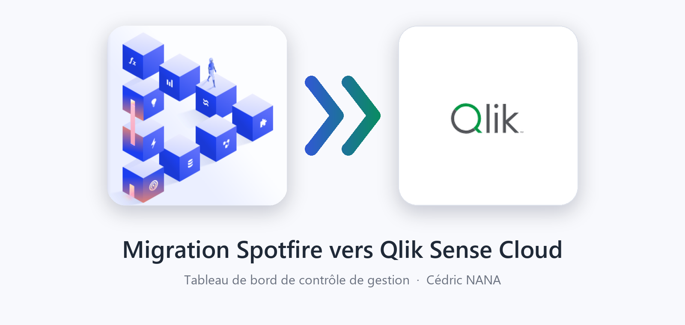
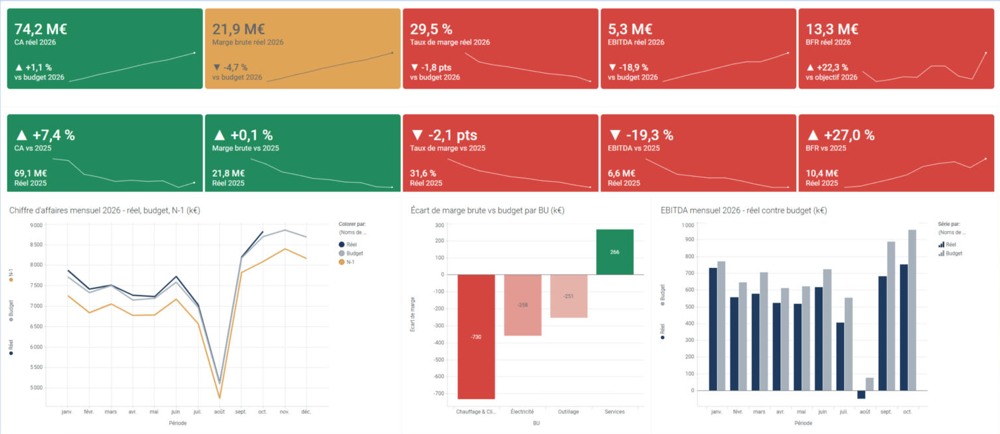
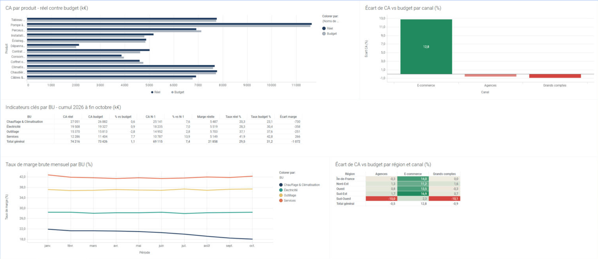
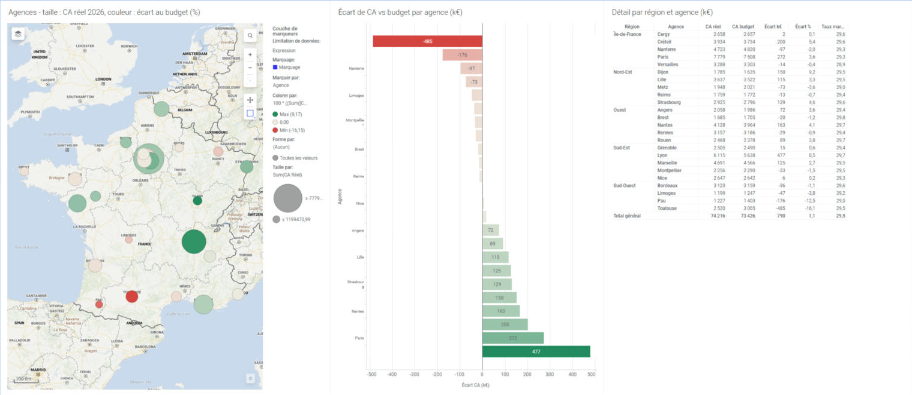
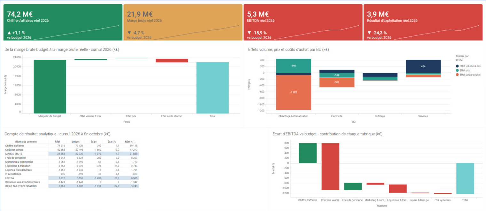
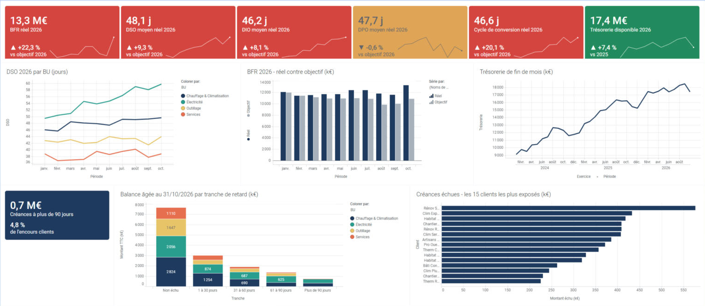
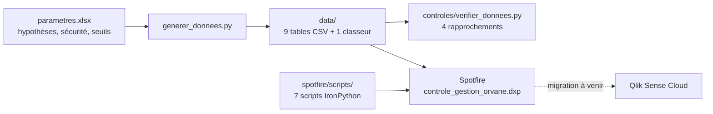

<p align="center">
  
</p>

<h1 align="center">Migrer un tableau de bord de contrôle de gestion<br />de Spotfire vers Qlik Sense</h1>

<p align="center">
  Un tableau de bord Spotfire de 5 onglets, construit entièrement par scripts versionnés,
  sur un jeu de données fictif de 14 892 lignes, pour servir de point de départ à une migration vers Qlik Sense Cloud.
</p>

<p align="center">
  <a href="README.md"></a>&nbsp;<a href="README.en.md"></a>
</p>

<p align="center">
  <a href="LICENSE"></a>
  <a href="https://github.com/cnanaj-wq/migration-spotfire-qlik-sense/actions/workflows/controle.yml"></a>
  
  
</p>

<p align="center">
  
  
  
  
  
  
  
  
  
  
</p>

<p align="center">
  <a href="#démarrage-rapide"><b>Démarrage</b></a>
  &nbsp;·&nbsp; <a href="#architecture">Architecture</a>
  &nbsp;·&nbsp; <a href="docs/reproduire.md">Reproduire dans Spotfire</a>
  &nbsp;·&nbsp; <a href="#limites">Limites</a>
</p>

## Démarrage rapide

Prérequis : Python 3.12. Spotfire n'est nécessaire que pour ouvrir le tableau de bord.

```powershell
git clone https://github.com/cnanaj-wq/migration-spotfire-qlik-sense.git
cd migration-spotfire-qlik-sense
pip install -r requirements.txt
python generer_donnees.py
python controles/verifier_donnees.py
```

Résultat attendu : les 9 fichiers de `data/` sont régénérés à l'identique, puis le contrôle affiche 4 lignes `OK` et `Tout concorde`.

## Choisis ta prochaine étape

| Tu veux… | Va ici |
|---|---|
| Ouvrir le tableau de bord dans Spotfire | [docs/reproduire.md](docs/reproduire.md) |
| Lire comment un onglet est construit | [`spotfire/scripts/`](spotfire/scripts/) |
| Comprendre le jeu de données | [`generer_donnees.py`](generer_donnees.py) |
| Changer les hypothèses (budget, sécurité, seuils) | [`parametres/parametres.xlsx`](parametres/) |
| Vérifier que les tables se recoupent | [`controles/verifier_donnees.py`](controles/verifier_donnees.py) |

## Pourquoi ce projet

Migrer un tableau de bord d'un outil à un autre ne se résume pas à redessiner des graphiques : les deux moteurs ne calculent pas et ne sélectionnent pas de la même façon. Pour le montrer sur un cas complet, il fallait une application de départ réaliste, reconstructible et sans donnée confidentielle.

Ce dépôt contient cette application : le pilotage d'une société fictive, Orvane Distribution, vu par son contrôle de gestion. Elle répond à quatre questions : quels indicateurs dérivent, où, pourquoi, et sur quel levier agir.

## Ce qu'il y a dedans

| Élément | Nombre | Où |
|---|---|---|
| Onglets du tableau de bord | 5 | [`spotfire/controle_gestion_orvane.dxp`](spotfire/) |
| Visuels (dont 5 rangées de 21 tuiles) | 25 | [`spotfire/scripts/`](spotfire/scripts/) |
| Scripts IronPython de construction | 7 | [`spotfire/scripts/`](spotfire/scripts/) |
| Tables de données (CSV) | 9 | [`data/`](data/) |
| Lignes de données | 14 892 | [`data/`](data/) |
| Rapprochements contrôlés | 4 | [`controles/verifier_donnees.py`](controles/verifier_donnees.py) |

Les cinq onglets :

| Onglet | Ce qu'il montre |
|---|---|
| Synthèse direction | CA, marge brute, taux de marge, EBITDA et BFR : réel, écart au budget, écart à N-1 |
| Chiffre d'affaires et marge | CA par produit, écart par canal, indicateurs par BU, taux de marge mensuel |
| Carte des agences | 24 agences sur une carte, classement des écarts de CA en valeur |
| Écarts et compte de résultat | Effets volume, prix et coûts d'achat, compte de résultat avec soldes intermédiaires |
| BFR, trésorerie et balance âgée | BFR, DSO, DIO, DPO contre objectif, trésorerie, créances échues |

## Aperçu

L'application de départ dans Spotfire, onglet « Synthèse direction ». Les captures de l'application migrée dans Qlik Sense viendront en regard.

<p align="center">
  
</p>

<details>
<summary>Voir les quatre autres onglets</summary>

**Chiffre d'affaires et marge**



**Carte des agences**



**Écarts et compte de résultat**



**BFR, trésorerie et balance âgée**



</details>

## Architecture



Le tableau de bord n'est pas dessiné à la main. Un script lanceur, enregistré dans le document Spotfire, exécute [`construire_tout.py`](spotfire/scripts/construire_tout.py), qui recrée les cinq onglets à partir des scripts du dépôt. Chaque changement d'un visuel est donc un changement de code, relu et versionné.

## Résultats

Chiffres du cumul 2026 à fin octobre, lus dans le tableau de bord et recoupés avec les fichiers de `data/` :

| Indicateur | Réel | Budget | Écart |
|---|---|---|---|
| Chiffre d'affaires | 74 216 k€ | 73 426 k€ | +790 k€ |
| Marge brute | 21 858 k€ | 22 930 k€ | −1 072 k€ |
| EBITDA | 5 312 k€ | 6 550 k€ | −1 238 k€ |
| Résultat d'exploitation | 3 863 k€ | 5 102 k€ | −1 238 k€ |

Le scénario est volontaire : l'entreprise vend plus que prévu, mais sa marge se dégrade. Pour retrouver le chiffre d'affaires et l'écart de marge : `python controles/verifier_donnees.py`.

## Plan du dépôt

```
generer_donnees.py      génère le jeu de données fictif à partir des paramètres
creer_parametres.py     crée le classeur de paramètres initial (une seule fois)
parametres/             hypothèses, sécurité par région, seuils d'alerte
data/                   9 tables CSV et le même contenu en classeur Excel
controles/              contrôle de cohérence entre les tables
spotfire/               le document Spotfire et ses scripts de construction
docs/                   mode d'emploi Spotfire, script du bandeau
img/                    visuels du README et captures d'écran
```

## Limites

- **La migration vers Qlik Sense n'est pas encore faite.** Le dépôt contient aujourd'hui l'application de départ. Le modèle, les expressions et les feuilles Qlik viendront ensuite.
- **Sécurité par région : restriction d'affichage, pas contrôle d'accès.** Le script [`06_securite.py`](spotfire/scripts/06_securite.py) limite les visuels aux régions du profil choisi dans la table `securite`. Les données restent embarquées dans le document : un vrai cloisonnement demande Spotfire Server. Les tables sans région (compte de résultat, BFR, trésorerie) restent visibles en entier.
- **Construction non automatisable hors de Spotfire.** Les scripts IronPython ne s'exécutent que dans Spotfire ; le contrôle automatique du dépôt ne vérifie que leur syntaxe.

## Auteur

**Cédric NANA** · Consultant BI & Data · [GitHub](https://github.com/cnanaj-wq)
