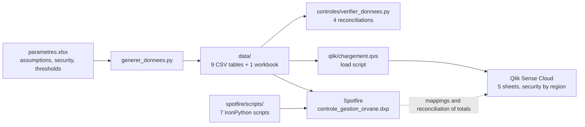
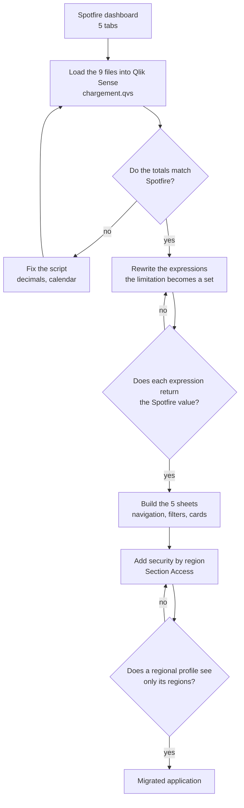

# Architecture and technical detail

This document holds the detail that used to sit in the README: what the repository contains, the architecture, the LAB 01 flowchart, the scenario figures and the folder map.

## What is inside

| Item | Count | Where |
|---|---|---|
| Dashboard tabs | 5 | [`spotfire/controle_gestion_orvane.dxp`](../spotfire/) |
| Visuals (including 5 rows of 21 KPI tiles) | 25 | [`spotfire/scripts/`](../spotfire/scripts/) |
| IronPython build scripts | 7 | [`spotfire/scripts/`](../spotfire/scripts/) |
| Data tables (CSV) | 9 | [`data/`](../data/) |
| Data rows | 14,892 | [`data/`](../data/) |
| Sheets in the Qlik Sense application | 5 | [`img/qlik/`](../img/qlik/) |
| Tabs in the Qlik Sense load script | 7 | [`qlik/chargement.qvs`](../qlik/chargement.qvs) |
| Totals compared between Spotfire and Qlik Sense | 11 | [qlik/correspondances.md](../qlik/correspondances.md) |
| Reconciliation checks | 4 | [`controles/verifier_donnees.py`](../controles/verifier_donnees.py) |

The five tabs, carried over as five Qlik Sense sheets:

| Tab | What it shows |
|---|---|
| Executive summary | Revenue, gross margin, margin rate, EBITDA and working capital: actual, gap to budget, gap to prior year |
| Revenue and margin | Revenue by product, gap by channel, indicators by business unit, monthly margin rate |
| Branch map | 24 branches on a map, ranking of revenue gaps in value |
| Variances and income statement | Volume, price and purchase cost effects, income statement with intermediate balances |
| Working capital, cash and aged balance | Working capital, DSO, DIO, DPO against target, cash, overdue receivables |

The dashboard, the data columns and the scripts are in French.

Two visual counts are in use, and they describe the same dashboard. The Spotfire scripts create 25 visuals: 20 charts, tables and map, plus 5 rows of tiles. LAB 02 counts each tile separately: 20 + 21 KPI cards, which gives 41.

The same goes for files: `data/` holds 9 CSV tables, and an Excel workbook with the same content. The 14,892 rows are those of the 9 tables.

## Architecture



The dashboard is not drawn by hand. A launcher script, stored in the Spotfire document, runs [`construire_tout.py`](../spotfire/scripts/construire_tout.py), which recreates the five tabs from the scripts in this repository. Every change to a visual is therefore a code change, reviewed and versioned.

On the Qlik Sense side, the nine files in `data/` are loaded by [`chargement.qvs`](../qlik/chargement.qvs) into a single fact table surrounded by five dimension tables. [correspondances.md](../qlik/correspondances.md) (in French) describes what changes: the model, how expressions are written, and security.

## LAB 01 flowchart

The migration steps, with the checks that decide what happens next:



## Scenario figures

Year-to-date figures at the end of October 2026, read in the dashboard and reconciled with the files in `data/`:

| Indicator | Actual | Budget | Gap |
|---|---|---|---|
| Revenue | 74,216 k€ | 73,426 k€ | +790 k€ |
| Gross margin | 21,858 k€ | 22,930 k€ | −1,072 k€ |
| EBITDA | 5,312 k€ | 6,550 k€ | −1,238 k€ |
| Operating income | 3,863 k€ | 5,102 k€ | −1,238 k€ |

The scenario is deliberate: the company sells more than planned, but its margin deteriorates. To recompute revenue and the margin gap: `python controles/verifier_donnees.py`.

The Qlik Sense application returns the same totals: 11 indicators compared, listed in [correspondances.md](../qlik/correspondances.md).

## Repository map

```
generer_donnees.py      generates the fictional dataset from the parameters
creer_parametres.py     creates the initial parameter workbook (once)
parametres/             assumptions, security by region, alert thresholds
data/                   9 CSV tables and the same content as an Excel workbook
controles/              consistency check across tables
spotfire/               the Spotfire document and its build scripts
qlik/                   the Qlik Sense load script and the mappings between the two tools
index.html, processus.html  the project page (GitHub Pages) and its interactive diagram
design/                 the interactive diagram specification
lab02/                  the automated migration: .dxp extraction, rule-based conversion, generation, SQL check
docs/                   Spotfire how-to, banner script
img/                    README visuals and screenshots
```
