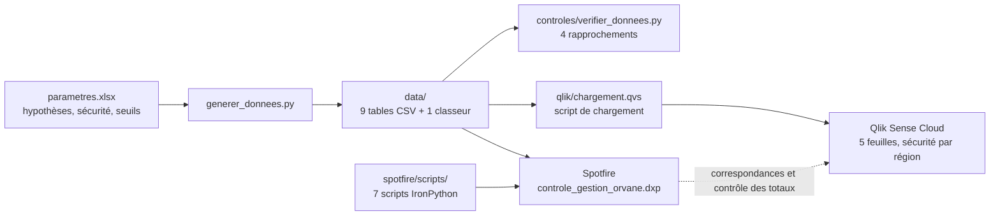
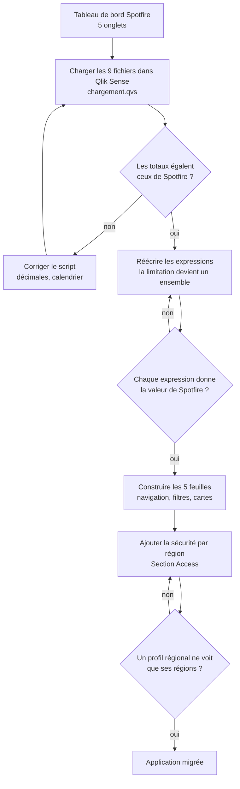

# Architecture et détail technique

Ce document reprend le détail qui figurait dans le README : le contenu du dépôt, l'architecture, le logigramme du LAB 01, les chiffres du scénario et le plan des dossiers.

## Ce qu'il y a dedans

| Élément | Nombre | Où |
|---|---|---|
| Onglets du tableau de bord | 5 | [`spotfire/controle_gestion_orvane.dxp`](../spotfire/) |
| Visuels (dont 5 rangées de 21 tuiles) | 25 | [`spotfire/scripts/`](../spotfire/scripts/) |
| Scripts IronPython de construction | 7 | [`spotfire/scripts/`](../spotfire/scripts/) |
| Tables de données (CSV) | 9 | [`data/`](../data/) |
| Lignes de données | 14 892 | [`data/`](../data/) |
| Feuilles de l'application Qlik Sense | 5 | [`img/qlik/`](../img/qlik/) |
| Onglets du script de chargement Qlik Sense | 7 | [`qlik/chargement.qvs`](../qlik/chargement.qvs) |
| Totaux comparés entre Spotfire et Qlik Sense | 11 | [qlik/correspondances.md](../qlik/correspondances.md) |
| Rapprochements contrôlés | 4 | [`controles/verifier_donnees.py`](../controles/verifier_donnees.py) |

Les cinq onglets, repris en cinq feuilles Qlik Sense :

| Onglet | Ce qu'il montre |
|---|---|
| Synthèse direction | CA, marge brute, taux de marge, EBITDA et BFR : réel, écart au budget, écart à N-1 |
| Chiffre d'affaires et marge | CA par produit, écart par canal, indicateurs par BU, taux de marge mensuel |
| Carte des agences | 24 agences sur une carte, classement des écarts de CA en valeur |
| Écarts et compte de résultat | Effets volume, prix et coûts d'achat, compte de résultat avec soldes intermédiaires |
| BFR, trésorerie et balance âgée | BFR, DSO, DIO, DPO contre objectif, trésorerie, créances échues |

Deux comptes de visuels circulent et ils décrivent le même tableau de bord. Les scripts Spotfire créent 25 visuels : 20 graphiques, tableaux et carte, plus 5 rangées de tuiles. Le LAB 02 compte chaque tuile séparément : 20 + 21 cartes d'indicateur, soit 41.

De même pour les fichiers : `data/` contient 9 tables CSV et un classeur Excel qui reprend le même contenu. Les 14 892 lignes sont celles des 9 tables.

## Architecture



Le tableau de bord n'est pas dessiné à la main. Un script lanceur, enregistré dans le document Spotfire, exécute [`construire_tout.py`](../spotfire/scripts/construire_tout.py), qui recrée les cinq onglets à partir des scripts du dépôt. Chaque changement d'un visuel est donc un changement de code, relu et versionné.

Côté Qlik Sense, les neuf fichiers de `data/` sont chargés par [`chargement.qvs`](../qlik/chargement.qvs) dans une table de faits unique, entourée de cinq tables de dimensions. [correspondances.md](../qlik/correspondances.md) décrit ce qui change : le modèle, l'écriture des expressions et la sécurité.

## Logigramme du LAB 01

Les étapes de la migration, avec les contrôles qui décident de la suite :



## Les chiffres du scénario

Chiffres du cumul 2026 à fin octobre, lus dans le tableau de bord et recoupés avec les fichiers de `data/` :

| Indicateur | Réel | Budget | Écart |
|---|---|---|---|
| Chiffre d'affaires | 74 216 k€ | 73 426 k€ | +790 k€ |
| Marge brute | 21 858 k€ | 22 930 k€ | −1 072 k€ |
| EBITDA | 5 312 k€ | 6 550 k€ | −1 238 k€ |
| Résultat d'exploitation | 3 863 k€ | 5 102 k€ | −1 238 k€ |

Le scénario est volontaire : l'entreprise vend plus que prévu, mais sa marge se dégrade. Pour retrouver le chiffre d'affaires et l'écart de marge : `python controles/verifier_donnees.py`.

L'application Qlik Sense donne les mêmes totaux : 11 indicateurs comparés, listés dans [correspondances.md](../qlik/correspondances.md).

## Plan du dépôt

```
generer_donnees.py      génère le jeu de données fictif à partir des paramètres
creer_parametres.py     crée le classeur de paramètres initial (une seule fois)
parametres/             hypothèses, sécurité par région, seuils d'alerte
data/                   9 tables CSV et le même contenu en classeur Excel
controles/              contrôle de cohérence entre les tables
spotfire/               le document Spotfire et ses scripts de construction
qlik/                   le script de chargement Qlik Sense et les correspondances entre les deux outils
index.html, processus.html  la page du projet (GitHub Pages) et son schéma interactif
design/                 la description du schéma interactif
lab02/                  la migration automatisée : extraction du .dxp, conversion par règles, génération, contrôle SQL
docs/                   mode d'emploi Spotfire, script du bandeau
img/                    visuels du README et captures d'écran
```
