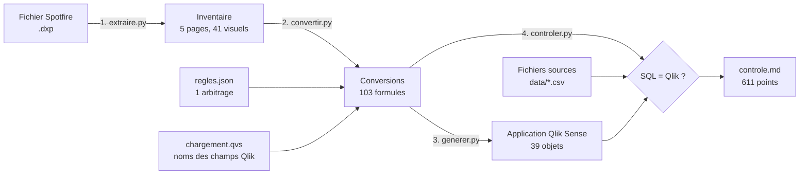
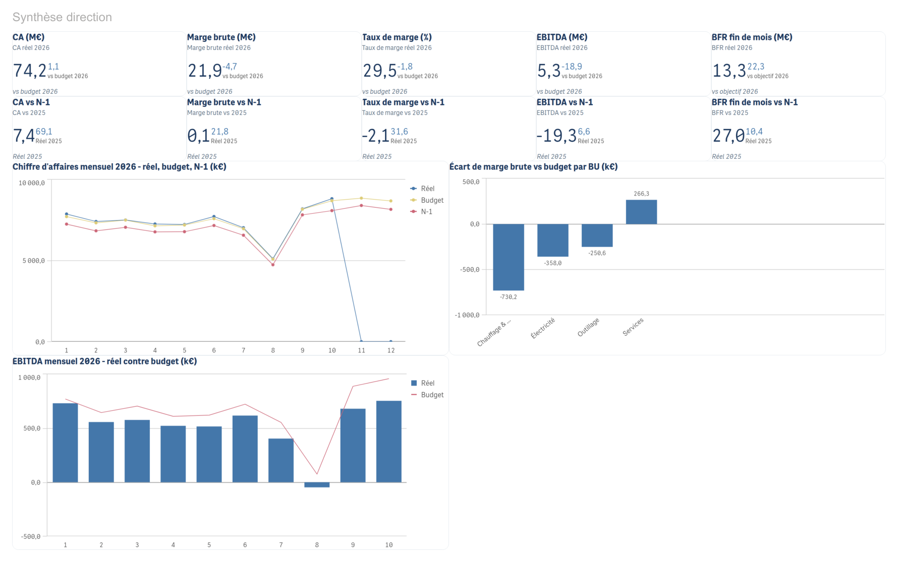

# LAB 02 : la même migration, automatisée en Python

Le LAB 01 a refait le tableau de bord Spotfire dans Qlik Sense à la main, visuel par visuel.
Ici, quatre scripts font le même trajet : ils lisent le fichier Spotfire, traduisent ses
formules, construisent l'application Qlik et vérifient chaque chiffre.

Aucun script ne devine. Une formule que les règles ne couvrent pas n'est pas traduite : elle
est listée « à arbitrer », avec la raison, pour qu'une personne décide.

## Le trajet



| Étape | Script | Ce qu'il fait | Résultat |
|---|---|---|---|
| 1. Extraire | `extraire.py` | Ouvre le fichier `.dxp` (une archive ZIP) et lit son document, sans lancer Spotfire | `sorties/inventaire.json` |
| 2. Convertir | `convertir.py` | Traduit chaque formule Spotfire deux fois : en formule Qlik et en requête SQL | `sorties/conversions.json` |
| 3. Générer | `generer.py` | Crée l'application, charge les données, pose un objet Qlik par visuel | application Qlik Sense |
| 4. Contrôler | `controler.py` | Compare, point par point, le SQL calculé sur les fichiers sources à ce que Qlik affiche | `sorties/controle.md` |

`spotfire.py` lit la syntaxe des formules Spotfire ; les étapes 2 à 4 s'appuient dessus.

## Lancer

```
python lab02/extraire.py
python lab02/convertir.py
python lab02/generer.py --creer
python lab02/controler.py <identifiant de l'application>
```

Les deux premières commandes ne demandent que Python. Les deux suivantes demandent l'outil en
ligne de commande `qlik`, connecté à un tenant Qlik Cloud où les fichiers de `data/` sont
déposés dans `DataFiles/Orvane/`. Avant `--creer`, la variable d'environnement
`QLIK_ADMINISTRATEUR` reçoit l'adresse e-mail de la personne qui recharge (voir
[la sécurité par région](../qlik/correspondances.md)).

## Résultats

Relevés sur les sorties de ce dossier, pour le fichier `spotfire/controle_gestion_orvane.dxp`.

| Mesure | Résultat |
|---|---|
| Pages lues dans le fichier Spotfire | 5 |
| Visuels lus (20 graphiques, tableaux et carte ; 21 cartes d'indicateur) | 41 |
| Formules de mesure trouvées | 103 |
| Formules converties par règles | 103 |
| Visuels laissés à l'arbitrage | 2 |
| Objets Qlik générés | 39 sur 41 |
| Points contrôlés en SQL (une valeur par mesure et par BU, mois, agence...) | 611 |
| Points conformes | 611 |

Les deux visuels laissés à l'arbitrage :

- le compte de résultat analytique, qui s'appuie sur une table préparée dans Spotfire
  (`resultat_lignes`) et absente du modèle Qlik ;
- les 15 clients les plus exposés, dont le filtre est un classement (`DenseRank`) qu'aucune
  règle ne traduit.

Le premier contrôle n'a pas donné 611 sur 611, mais 518. Deux causes, toutes deux dans les
scripts : une règle traduisait `Integer()` par une fonction qui n'existe pas dans Qlik, et le
script de contrôle lisait mal certaines valeurs nulles. Le contrôle SQL a montré les neuf
mesures touchées ; la règle a été corrigée.

## Ce que les scripts ont produit

La première feuille de l'application générée, sans aucune retouche. Les quatre autres sont
dans [`img/lab02/`](../img/lab02/).



## Les règles de conversion

| Dans Spotfire | Dans Qlik Sense | Formules concernées |
|---|---|---|
| Limitation de données du visuel | Analyse d'ensembles dans chaque agrégat | 99 |
| `Sum(...) OVER (AllPrevious([Axis.X]))` dans une carte d'indicateur | Total de la période (le cumul lu à son dernier point) | 36 |
| Nom de colonne | Nom du champ, lu dans `qlik/chargement.qvs` | 34 |
| `Sum(If(condition, colonne))` | La condition sort de l'agrégat, en analyse d'ensembles | 26 |
| Carte d'indicateur sans cumul | Valeur du dernier mois de l'axe | 24 |
| `Real(x)` | `x` | 15 |
| `Integer(Round(x))` | `Round(x)` | 8 |
| `Round(x, 1)` | `Round(x, 0.1)` | 7 |

Exemple, la carte « BFR fin de mois » :

```
Spotfire   Sum(If([Exercice] = 2026, [BFR])) / 1000000
           limitation : [Mois] <= 10 and [Exercice] >= 2025

Qlik       (Sum({<Mois={"<=10"}*{$(=Max({<Mois={"<=10"}, Exercice={">=2025"}>} Mois))},
                  Exercice={">=2025"}*{2026}>} BFR)) / 1000000

SQL        SELECT (SUM(CASE WHEN "Exercice" = 2026.0 THEN "BFR" END)) / 1000000.0 FROM "bfr"
           WHERE "Mois" <= 10.0 AND "Exercice" >= 2025.0
             AND "Mois" = (SELECT MAX("Mois") FROM "bfr" WHERE "Mois" <= 10.0 AND "Exercice" >= 2025.0)
```

## Ce qui reste à une personne

`regles.json` porte la seule décision que les scripts ne pouvaient pas prendre : la colonne
calculée `Période` de Spotfire (le nom du mois) est rattachée au champ `Mois`.

Les chiffres sont justes, la forme ne l'est pas encore. Par rapport au LAB 01, l'application
générée n'a pas : l'ordre des barres, les noms de mois, les couleurs de la charte, les formats
(k€, %), les cascades (rendues en barres), la navigation, les filtres. La courbe de trésorerie
sort avec une série par mois au lieu d'un axe continu.

## Limites

- Le format `.dxp` n'est pas documenté. L'extraction a été écrite pour ce fichier, enregistré
  avec Spotfire 14.6 ; elle n'a été essayée sur aucun autre.
- La formule Qlik et la requête SQL partent de la même lecture de la formule Spotfire. Une
  règle mal comprise (par exemple « la carte affiche le dernier mois ») produirait deux
  résultats faux et identiques : le contrôle ne la verrait pas.
- Le contrôle ne compare pas à Spotfire lui-même. Un seul recoupement a été fait à la main :
  le chiffre d'affaires cumulé, 74 215 646,71, identique à celui du LAB 01.
- Les règles couvrent les fonctions utilisées par ce tableau de bord, pas tout le langage
  Spotfire.
- Les briques d'objets Qlik (gabarits, dimension, mesure) sont celles du LAB 01, dans
  `qlik/construire_feuilles.py`.
- Une seule exécution de bout en bout, sur un seul tenant.
